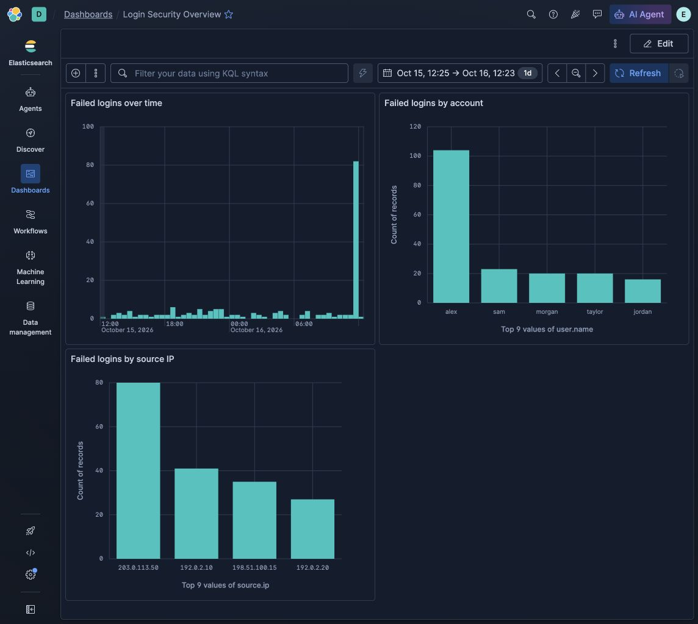

# Investigating Repeated Failed Logins with Kibana

A guided personal SIEM lab using Kibana and Elasticsearch in a local Docker environment. The goal was to identify suspicious authentication patterns and support a conclusion with logs and dashboard charts.

## Result

The 680 simulated events contain 183 failed logins and 497 successful logins. Account `alex` has 104 failures overall. Of those, 80 came from `203.0.113.50` at two-second intervals between **16:51:33.566766 and 16:54:11.566766 UTC on October 16, 2026**. The regular timing is consistent with automated password guessing. This dataset contains no successful login from that source; it does not establish an account compromise.

The dashboard screenshot displays dates in America/Chicago. On the event date, the burst is 11:51:33–11:54:11 CDT. The 104 account failures include the 80-event burst and 24 failures from other sources.

## Investigation

1. Selected the **Practice login events** data view for index `learning-auth`.
2. Expanded the time range to cover October 15–16, 2026, rather than the default last 15 minutes.
3. Filtered failures with `event.outcome : "failure"`.
4. Compared accounts and found that `alex` had the most failures.
5. Examined the timeline for a concentrated burst.
6. Isolated `alex` and `203.0.113.50` to connect the source, account, and event timing.
7. Checked whether that source had any successful logins.

[Investigation queries](queries.kql) · [Detailed findings](investigation.md) · [Restore instructions](RESTORE.md)

## Dashboard panels

| Panel | Configuration | Purpose |
| --- | --- | --- |
| Failed logins over time | Date histogram of `@timestamp`; count of records | Locate unusual bursts |
| Failed logins by account | Top values of `user.name`; count of records | Identify affected accounts |
| Failed logins by source IP | Top values of `source.ip`; count of records | Identify sources with repeated failures |

Each panel stores the failure query. The dashboard stores the absolute lab time range. The saved dashboard was reopened from the dashboard list to verify persistence.

## Included files

- `screenshots/dashboard.jpg`: verified dashboard screenshot.
- `exports/dashboard.ndjson`: Kibana saved-object export containing the dashboard, all three Lens visualizations, and the data view.
- `data/sample-login-events.ndjson`: the 680 simulated events, one document per line.
- `data/index-mapping.json`: field mappings for importing the events.
- `queries.kql`: investigation searches, one per section.

## Scope and learning

All account names, source addresses, and events are invented. The lab does not generate attacks or collect real authentication data. It was completed with AI guidance for setup, investigation, charts, and documentation.

The work practiced KQL filtering, aggregations, time ranges, evidence-based conclusions, and saving reusable dashboards. A useful next exercise is to repeat the investigation independently on a different simulated dataset.
